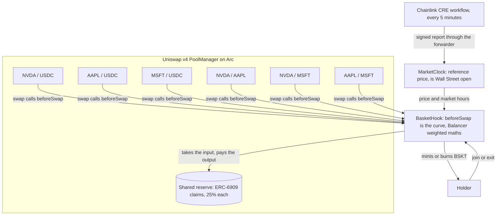

# Tiffin Fi

The ETF that pays you.

A stock fund that gets paid to rebalance. Nvidia, Apple, Microsoft and USDC in one token, run by one
Uniswap v4 hook on Arc. The hook prices every swap with Balancer's weighted maths over one shared reserve,
and a Chainlink CRE workflow tells it Wall Street's price and hours, so Monday's opening gap pays the fund
instead of the first bot.

Built at ETHGlobal Mumbai 2026. **Live app: [tiffinfi.vercel.app](https://tiffinfi.vercel.app)**

## Arc track: built end to end in Arc Studio

Bounty: **Best DeFi / Onchain Finance App Built End to End in Arc Studio.**

**Arc Studio project: [studio.arc.io/app/fdcb28e0-c08d-4981-9c0d-9a7ae25774d0](https://studio.arc.io/app/fdcb28e0-c08d-4981-9c0d-9a7ae25774d0)**

The Studio project started from a plain description of Tiffin Fi, with no code uploaded. Arc Studio then did four
things:

1. Wrote the contracts and 114 Foundry tests, including fuzz and invariant tests, and reviewed them.
2. Added the exit fee its review asked for.
3. Deployed everything to Arc testnet from its own wallet. Its `BasketBootstrap` contract puts the hook at its v4
   flag address and opens the six pools, because the platform wallet can't call the CREATE2 deployer directly.
4. Built the web app.

Its code is in [`studio/`](studio/), pulled from the workspace with `arc-studio pull`.

| Arc Studio deployment | Address |
|---|---|
| BasketHook (BSKT) | [`0x4ff4fb09A5934aa98e5740465A5535fb25c6e888`](https://explorer.testnet.arc.io/address/0x4ff4fb09A5934aa98e5740465A5535fb25c6e888) |
| MarketClock | [`0x25610623501dfa7e73d5309ce7e31058bb487809`](https://explorer.testnet.arc.io/address/0x25610623501dfa7e73d5309ce7e31058bb487809) |
| BasketRouter | [`0x34666e4b2b5022071c8205474ee8e252812bfd74`](https://explorer.testnet.arc.io/address/0x34666e4b2b5022071c8205474ee8e252812bfd74) |
| BasketBootstrap | [`0x51aa0273fc2e426b7c2487256c5211e0bf98b11f`](https://explorer.testnet.arc.io/address/0x51aa0273fc2e426b7c2487256c5211e0bf98b11f) |
| tNVDA / tAAPL / tMSFT | [`0xe99e…dc50`](https://explorer.testnet.arc.io/address/0xe99e06837468301ec7fab24e7092aefccda8dc50), [`0x8460…a325`](https://explorer.testnet.arc.io/address/0x846073a79a94e1c64c946855ec4f8d59ef5ba325), [`0x4925…5cba6`](https://explorer.testnet.arc.io/address/0x4925d2907dbfd3801aee4165a0214df330b5cba6) |

`scripts/studio.mjs verify` re-checks on chain everything Studio reported, and all 19 checks pass:

- the hook's address and flags (`0x2888`);
- the owners and minters;
- the asset order;
- both Chainlink CRE forwarders;
- all six pools initialised with the hook.

`scripts/studio.mjs seed` then pushed live prices,
[seeded the fund](https://explorer.testnet.arc.io/tx/0x5ba24d7e2c25c5e49232025be986947dff272c953deb7014c1ca89bdd1dc4a2e)
with $2 each of the three stocks and USDC ($8, share price $1.00), and routed
[a 0.1 USDC swap](https://explorer.testnet.arc.io/tx/0x4d745b906e9e24a809a344cd86aec9fe22ff3181c681ebc88cfbe1a0231ef620)
through Studio's router.

The Chainlink CRE workflow in [`cre/`](cre/) reports to Studio's MarketClock. A `cre workflow simulate --broadcast`
run fetched live quotes, reached consensus and
[wrote the report](https://explorer.testnet.arc.io/tx/0x11efa416c2514360c666bf0ff0641bf21ec07e5be9cf2a3f3a30cf0277a898bd)
through the CRE forwarder. Testnet has no arbitrage bots, so `scripts/studio.mjs rebalance` trades each pool back to
the clock's price. `scripts/push-prices.mjs --studio --every 60` is the owner fallback that keeps prices fresh
between CRE runs.

**How we got here.** We first prototyped Tiffin Fi with Claude Code. That prototype is the root of this repo
(`src/`, `app/`, and the deployment below). Arc requires Arc Studio as the starting point, so we rebuilt the Arc
track version from scratch in a fresh Studio project. An earlier Studio app where we only imported and audited the
prototype is not the submission.

## Prototype, live on Arc testnet

| Contract | Address |
|---|---|
| BasketHook (the hook, and the fund token BSKT) | [`0xbF0EF20ace8103D22DaDd9e98bF49Abc969a2888`](https://explorer.testnet.arc.io/address/0xbF0EF20ace8103D22DaDd9e98bF49Abc969a2888) |
| MarketClock (Chainlink CRE receiver) | [`0x11e65932196B07617180A8Fc5D1885BFd1170e9F`](https://explorer.testnet.arc.io/address/0x11e65932196B07617180A8Fc5D1885BFd1170e9F) |
| BasketRouter | [`0x5b4781DdBb82EA8Ce01A9ae8392646f89D2A54cf`](https://explorer.testnet.arc.io/address/0x5b4781DdBb82EA8Ce01A9ae8392646f89D2A54cf) |
| tNVDA / tAAPL / tMSFT (test shares) | [`0xb462…1548`](https://explorer.testnet.arc.io/address/0xb462642086474956f572bD5D9c5352F9FFe51548), [`0x7CD5…F55c`](https://explorer.testnet.arc.io/address/0x7CD5378302AF1086DbA7C6E4D3610e63ef71F55c), [`0x2136…97Ab`](https://explorer.testnet.arc.io/address/0x21369835194F59E895636F92359dE3C3241997Ab) |
| Uniswap v4 PoolManager (already on Arc) | [`0x8366a39CC670B4001A1121B8F6A443A643e40951`](https://explorer.testnet.arc.io/address/0x8366a39CC670B4001A1121B8F6A443A643e40951) |
| USDC (Arc's native USDC, ERC-20 interface) | `0x3600000000000000000000000000000000000000` |

Transactions you can check:

- Fund seeded with $4 each of tNVDA, tAAPL, tMSFT and Arc USDC: [join](https://explorer.testnet.arc.io/tx/0x59a7f92deb9c90f8cdc1767eace54abb7ea2a5d315a34e51f7a0634f65f5efd5).
- Monday replay: the reference price for Nvidia jumps 5% above the pool ([report](https://explorer.testnet.arc.io/tx/0x625616cfd66fcad90f8f2a8238ed81370ce60e1a887013d8114a919c224b7ccf)), then a bot buys the gap ([swap](https://explorer.testnet.arc.io/tx/0x1adca61ace051fba6695322d09163a21415ea5793aafd9db85de31da5d96b13d)). The bot's edge was $0.002439; the fund kept $0.001951 (80%), the bot $0.000488 (20%).
- The way back: real prices reported again ([report](https://explorer.testnet.arc.io/tx/0x0b7f5ba673fac41c6ab1c95a8f9fb82c34200f9272bf3c98c431baf7746c2098)) and the bot sells the gap back ([swap](https://explorer.testnet.arc.io/tx/0x6e87a5d9bce72d1cc9a005bdaadd0a30b25b6ac1e4468179e52acf7e667779bd)), again keeping only 20%.
- Chainlink CRE: a `cre workflow simulate --broadcast` run fetched live quotes, reached consensus and wrote the
  report to MarketClock through the CRE forwarder ([tx](https://explorer.testnet.arc.io/tx/0x70746a4373566f8a305357b89f8a1a513e252b235917725120e59a1a94aac996),
  `ReportApplied` in the receipt).
- Ordinary swaps: [USDC to AAPL](https://explorer.testnet.arc.io/tx/0xe0fd0dc2c61e5a7f8693a38c8f4dc35b49e26ac39ea63bd9c4e77dc50e4c385a) paid the 0.30% posted fee; [AAPL to MSFT](https://explorer.testnet.arc.io/tx/0xb79be01b1f3f6cb95b64485097b0e95d2195e9d6ed7ed3fce1c779bb44bba20c) is one hop through the same reserve.

- Rebalance: testnet has no arbitrage bots, so `scripts/rebalance.mjs` trades each pool back to Chainlink's price
  (each correction paid the gap fee to the fund) and then added 8 USDC with matching slices
  ([join](https://explorer.testnet.arc.io/tx/0x1b50400ba44c68a89a07c8b73b3ff293115633a941b307133353fa827614d44f)).
  The fund is now about $48.

The amounts are small because the Arc faucet gives 20 USDC every two hours. The maths is the same at any size:
on a $1M fund, a 5% Monday gap in Nvidia is worth about $228 to bots, and the hook keeps about $182 of it.

## How it works



**One hook, six pools, one reserve.** Every pair of the four assets is a v4 pool whose hook is `BasketHook`.
In `beforeSwap` the hook takes the whole input and pays the whole output, and returns a `BeforeSwapDelta` that
leaves nothing for v4's own concentrated-liquidity maths to swap. The hook keeps the fund's balances as ERC-6909
claims in the PoolManager. Claims are per token, not per pool, so all six pools trade against the same USDC.
Plain liquidity positions are blocked in `beforeAddLiquidity`; you join the fund through the hook and get BSKT.

**Balancer's maths.** The price of any swap comes from Balancer's weighted formula,
`out = B_out × (1 − (B_in / (B_in + A_in)) ^ (w_in / w_out))`. With every weight at 25% the power is 1, so a
swap between two assets is exactly `x · y = k` on their two balances, with no fractional powers. Buying or
selling the basket with a single asset uses Balancer's single-asset join and exit. With weight 1/4 that is a
fourth root (two square roots) or a fourth power, and the result is capped at the value the reference prices
give, so nobody can buy a stale fund cheaply that way either.

**Who gets paid.** Each swap pays the larger of two fees:

| Fee | Size | Where it goes |
|---|---|---|
| Posted fee | 0.30% while Wall Street is open, 0.60% while it's closed, 2% if prices are stale | 90% stays in the fund, 10% to the protocol |
| Gap fee | 80% of the trade's edge: what the trader receives at the reference price, minus what they paid | All of it stays in the fund |

On a normal trade the posted fee is larger. When the pool still shows Friday's price and Chainlink shows
Monday's, the first trader gets an edge and the gap fee takes 80% of it. Twenty percent of the biggest edge is
still the bot's biggest profit, so the bot still closes the whole gap; and because edges add up, splitting the
trade into pieces doesn't lower the fee. Both are tested. Fees stay in the reserve, so each BSKT redeems for more.

**The clock.** `MarketClock` stores a reference price per stock and whether the US market is open. A Chainlink CRE
workflow (`cre/`) fetches prices with node consensus, works out NYSE hours, and writes a signed report through
the forwarder to `onReport`. The owner can push the same report, which the Monday replay uses.

## What's real and what's test

- Real: Arc testnet, Uniswap's v4 PoolManager on Arc, Arc's native USDC (the fund holds and settles in it), and
  stock prices taken from the market.
- Test: the three stock tokens (`MockStock`, mintable only by the deployer, so nobody can mint shares and sell them
  into the fund). On mainnet the fund would hold issuer tokens such as xStocks or Ondo's.
- The Monday replay pushes the reference price itself to show a gap on demand; in production the CRE workflow
  writes it.

## Security notes

- The reference price can only make a trade more expensive or a payout smaller. The curve sets the price; the
  clock only adds the gap fee and caps single-asset joins and exits with a `min()`. A wrong price can annoy
  traders but can't drain the fund: at worst the fund behaves like a plain weighted pool.
- The gap fee is capped at 10% of the output. Prices older than 6 hours switch the gap fee off and charge the 2%
  posted fee instead.
- `MarketClock` takes reports from Chainlink's forwarders and from the owner. The simulation forwarder is meant
  for testing, so it is allowlisted for the demo only; the owner can remove it with `setForwarder`.
- `beforeSwapReturnDelta` is the most powerful hook permission. The hook only moves its own claims, by the
  amounts it quotes, and the tests cover swap, join and exit accounting.
- Hackathon code, unaudited, testnet only.

## Repo

```
src/BasketHook.sol    the hook, the curve, fees, joins and exits, and the BSKT token
src/MarketClock.sol   CRE receiver: reference prices and market hours
src/BasketRouter.sol  minimal exact-input router used by the app and scripts
src/MockStock.sol     test share token
test/                 Foundry tests on a local PoolManager
script/Deploy.s.sol   Arc deployment with a mined hook address
scripts/              viem scripts: seed the fund, Monday replay, swaps
cre/                  Chainlink CRE workflow
app/                  mobile web app
FEEDBACK.md           feedback for Uniswap
```

Run the tests:

```bash
forge test
```

Deploy and demo on Arc testnet (needs `PRIVATE_KEY` exported in your shell, and testnet USDC from
[faucet.circle.com](https://faucet.circle.com)):

```bash
NVDA_PRICE=188705000000000000000 AAPL_PRICE=344850000000000000000 MSFT_PRICE=538150000000000000000 MARKET_OPEN=true SEED_USDC=4000000 forge script script/Deploy.s.sol --rpc-url arc --broadcast --slow
```

```bash
npm install && node scripts/seed.mjs && node scripts/monday.mjs
```

Arc's USDC checks a blocklist precompile that Foundry's local simulation can't run, so the deploy script stops
before the first USDC transfer and `scripts/seed.mjs` sends the join with viem.

## Partners

- **Uniswap v4:** a custom-curve hook (`beforeSwap` with `BeforeSwapDelta`) that runs six pools from one reserve of
  ERC-6909 claims, with Balancer's weighted maths and a market-clock fee. Feedback in `FEEDBACK.md`.
- **Arc:** deployed on Arc testnet against the v4 PoolManager already there; the fund settles in Arc's USDC, and
  USDC pays the gas.
- **Chainlink CRE:** the workflow in `cre/` is the fund's clock; `MarketClock` is its on-chain receiver.

## AI usage

This project was built with Claude Code, Anthropic's coding agent, during the hackathon. The team chose the
product, the fee design and the partners. Claude Code wrote the contracts in `src/`, the tests in `test/`, the
deploy and demo scripts in `script/` and `scripts/`, the CRE workflow in `cre/` and the app in `app/` from that
design, and ran the tests and the Arc deployment. Commits made with AI assistance carry a
`Co-Authored-By: Claude` trailer.
